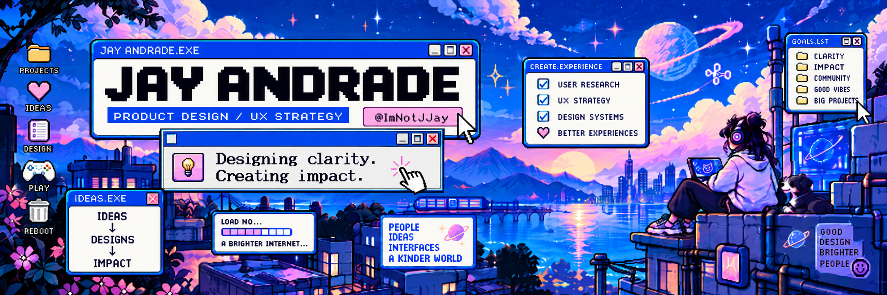

### Hey, I'm Jay. 👋

### Product Designer · Design Engineer · UX/UI Designer · UX Strategy

**Designing clarity. Creating impact.**

I believe great digital products start with understanding the right problems.

My approach to design connects **human needs, business objectives, and thoughtful experiences** — transforming complexity into clarity and opportunities into meaningful solutions.

📍 Based in Brazil 🇧🇷

---

## 01 / My Design Philosophy

For me, product design goes beyond creating beautiful interfaces. It's about understanding context, identifying opportunities, and making informed decisions.

I believe in:

- **People first** — Understanding real needs, behaviors, and challenges.
- **Strategic thinking** — Connecting design decisions to meaningful product goals.
- **Clarity through simplicity** — Reducing complexity without losing purpose.
- **Continuous learning** — Improving experiences through feedback and iteration.
- **Design with intention** — Making accessibility, consistency, and usability part of the process.

---

## 02 / How I Approach Problems

**01 — Discover**

Understand people, context, constraints, and opportunities.

**02 — Define**

Frame the right problem and align experience goals with business needs.

**03 — Explore**

Evaluate possibilities, structure experiences, and create thoughtful solutions.

**04 — Validate**

Learn from feedback, test assumptions, and refine decisions.

**05 — Evolve**

Build consistency, support scalability, and improve experiences over time.

---

## 03 / Areas of Interest

`Product Strategy` · `User Experience` · `UX Research` · `Interaction Design` · `Design Systems` · `Accessibility` · `Product Discovery`

---

## 04 / Selected Work

I'm organizing this space to share product design case studies, strategic thinking, and selected explorations.

My goal is to document not only the final experience, but also the problems, decisions, trade-offs, and learning behind each solution.

*Case studies will be added as they become available.*

---

## 05 / Let's Connect

I'm interested in conversations about product design, user experience, and building thoughtful digital products.

**[LinkedIn](https://www.linkedin.com/in/jay-andrade/)** · **[GitHub](https://github.com/ImNotJJay)**

---

*Good design is not just about what we create. It's about understanding why it matters.*
